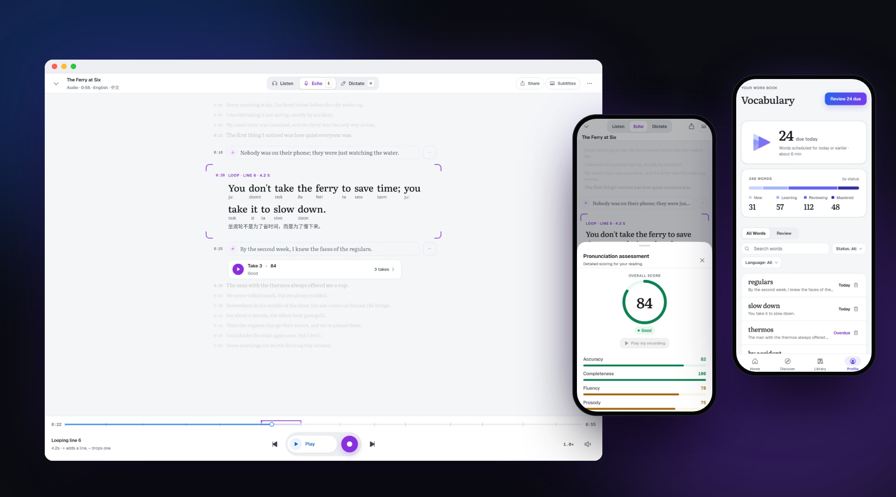
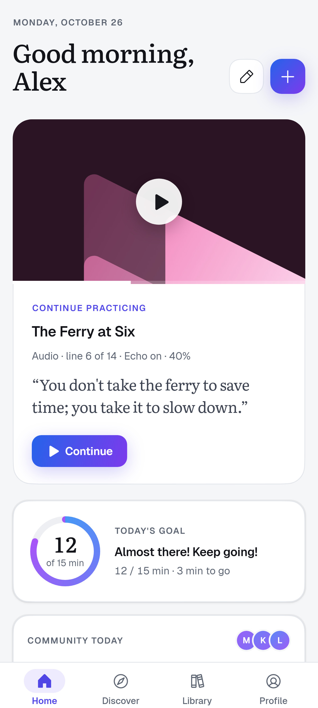
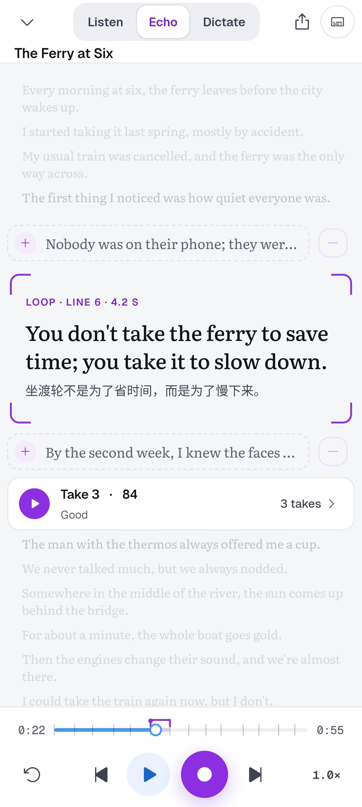
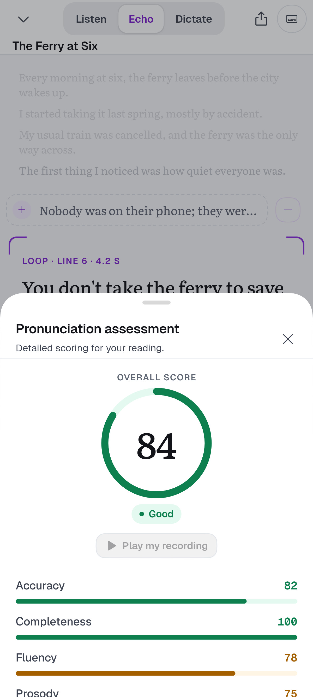
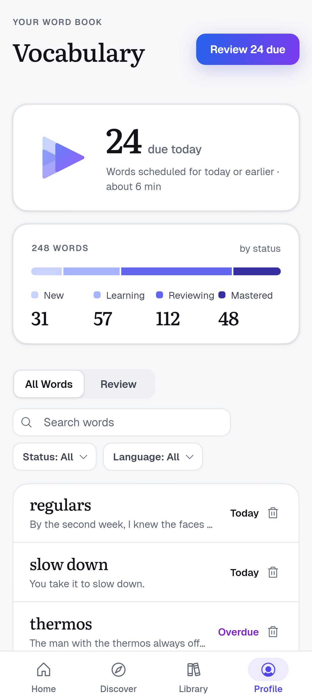
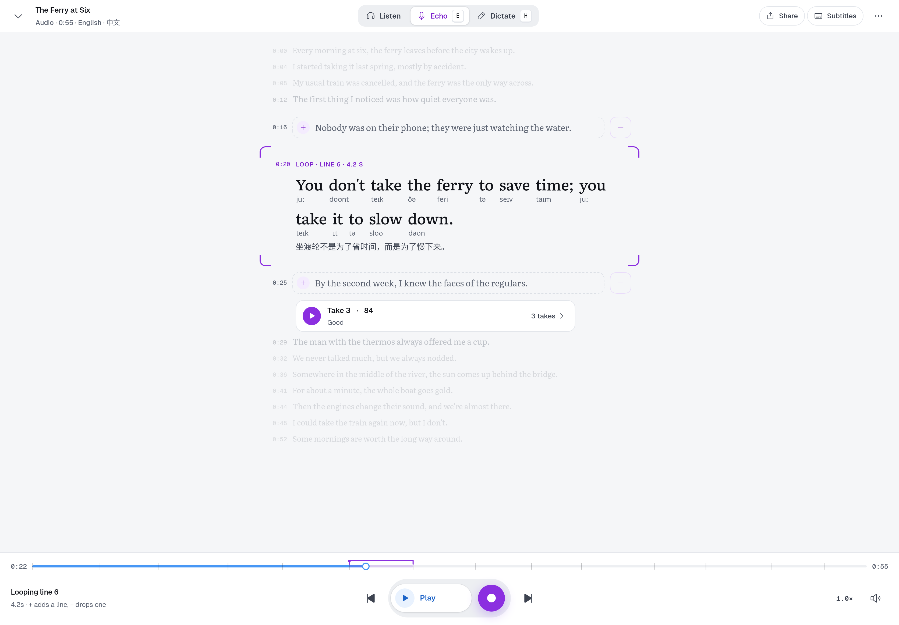

<p align="right">
  <a href="README.md">English</a> · <b>简体中文</b>
</p>

<h1 align="center">
  <br>
  Enjoy Player
</h1>

<p align="center">
  <strong>用你喜欢的媒体练外语。</strong>
  <br>
  打开你自己的视频和音频，或粘贴一个 YouTube 链接。逐句跟上、开口跟读、立刻评分——查过的生词也一并留下。
</p>

<p align="center">
  <a href="https://player.enjoy.bot"></a>
  <a href="https://github.com/baizhiheizi/enjoy_player/releases/latest"></a>
  <a href="LICENSE"></a>
</p>

<p align="center">
  <a href="https://player.enjoy.bot"></a>
</p>

<p align="center">
  <a href="landing/videos/enjoy-player-film.zh-CN.mp4"><b>▶ 观看 15 秒短片</b></a> · <a href="https://player.enjoy.bot">player.enjoy.bot</a>
</p>

---

## 练习闭环

媒体里的每一句，都有三种练法。随时切换，停在哪一句就从哪一句继续。

| | |
| --- | --- |
| 🔵 **听** | 每一句都与媒体同步。点一下就跳转，可单句循环、可放慢，需要时还能看译文和音标。 |
| 🟣 **跟读** | 一次跟读一句。在原声上录音、两相回放、对比音调，每次录音都有评分。 |
| 🟣 **听写** | 把字幕藏起来。单词变成色块，先用耳朵听，再悬停或长按一句偷看，检验自己。 |

## 看看实际效果

<table>
  <tr>
    <td align="center" width="25%"></td>
    <td align="center" width="25%"></td>
    <td align="center" width="25%"></td>
    <td align="center" width="25%"></td>
  </tr>
  <tr>
    <td align="center"><b>接着上次继续</b><br><sub>今日目标 · 社区</sub></td>
    <td align="center"><b>开口跟读</b><br><sub>循环 · 录音 · 对比</sub></td>
    <td align="center"><b>反馈细到每个音</b><br><sub>四个维度 · 逐词评分</sub></td>
    <td align="center"><b>生词记得住</b><br><sub>语境 · 间隔复习</sub></td>
  </tr>
</table>

<p align="center">
  
</p>

<p align="center"><sub><b>一个资料库，你的每一台设备。</b>Windows、macOS、Linux、iPhone、iPad 与 Android 原生应用。</sub></p>

---

## 功能

- **交互字幕** —— 支持 `.srt` / `.vtt` 导入、YouTube 字幕，或由 AI 转写并逐句对齐。点句跳转，划词查义；需要时可显示逐句译文和音标。
- **跟读（影子跟读）** —— 以句为单位循环，句末自动暂停并回退，反复打磨同一句也不打断节奏。每次录音都会保留。
- **发音评估** —— Azure 语音逐次评分：总分、准确度、完整度、流利度、韵律，细到每个单词，并把你的音高曲线叠在原声上对比。
- **听写** —— 按 `H` 把每句字幕换成色块，先用耳朵听，再悬停或长按一句偷看。
- **语境查词** —— 翻译、词典释义，以及 AI 对这个短语在当前场景中含义的解释，支持 15 种查词语言。
- **间隔重复生词本** —— 三档评分闪卡，按 SM-2 算法安排复习，每个词可绑定多个语境，付费套餐可导出 Anki CSV。
- **Craft 创作** —— 用母语说出或写下想说的话，Craft 按母语者的说法改写、朗读，并送进播放器跟读。
- **YouTube** —— 粘贴链接即可播放，自动获取字幕并渲染为交互字幕。
- **练习海报** —— 把一次跟读生成 9:16 海报（封面帧、台词、分数），一键分享。
- **同步** —— 资料库、进度、录音、生词本和设置随 Enjoy 账号在设备间同步。

---

## 立即获取

下载页会把适合你当前设备的安装包排在最前：**[player.enjoy.bot](https://player.enjoy.bot)**

| 平台 | 系统要求 | 获取 |
| --- | --- | --- |
| **Windows** | Windows 10 / 11 · x64 | [安装包（.exe）](https://player.enjoy.bot/#download) |
| **macOS** | macOS 12+ · Apple 芯片与 Intel · 已公证 | [磁盘映像（.dmg）](https://player.enjoy.bot/#download) |
| **Linux** | Ubuntu 22.04+ · x86_64 | [AppImage](https://player.enjoy.bot/#download) |
| **Android** | Android 8.0+ · 手机与平板 | [APK](https://player.enjoy.bot/#download) |
| **iPhone 与 iPad** | iOS 15+ | [TestFlight 公测](https://testflight.apple.com/join/6x7kkr3e) |

播放器和所有练习模式都免费；付费套餐提供更多每日 Enjoy AI 额度。刻意不提供 Flutter Web 版本。

版本与更新日志：**[github.com/baizhiheizi/enjoy_player/releases](https://github.com/baizhiheizi/enjoy_player/releases)**

---

## 技术栈

- **播放器** —— [media_kit](https://pub.dev/packages/media_kit)，全应用唯一引擎（[ADR-0003](docs/decisions/0003-player-core-media-kit.md)）
- **状态管理** —— [Riverpod 3](https://pub.dev/packages/flutter_riverpod) + `riverpod_annotation`
- **存储** —— [Drift](https://pub.dev/packages/drift)（SQLite），所有持久化数据
- **语音** —— Azure 发音评估 + 原生 FFmpeg 音高分析
- **设计** —— Duet 设计语言（[ADR-0093](docs/decisions/0093-duet-design-language.md)，[docs/design/duet/](docs/design/duet/README.md)）
- **架构** —— 参见 [docs/architecture.md](docs/architecture.md)；设计决策见 [docs/decisions/](docs/decisions/)

---

## 从源码构建

```bash
flutter pub get
dart run build_runner build   # 修改 Drift / Riverpod 注解后需要执行
flutter run
```

平台工具链要点：macOS 需要 Xcode + CocoaPods + `brew bundle install --file=macos/Brewfile`；Windows 需要把 NuGet 加入 `PATH`（`flutter_inappwebview` 依赖）；Linux 需要 `clang cmake ninja-build libgtk-3-dev libsqlite3-dev ffmpeg`，以及 YouTube 播放插件所需的 WPE WebKit 开发包（Ubuntu 上为 `libwpewebkit-2.0-dev libwpe-1.0-1 libwpebackend-fdo-1.0-dev`，Arch 上为 `wpewebkit libwpe wpebackend-fdo` —— 见 [docs/features/linux-platform.md](docs/features/linux-platform.md)）。完整发布前置条件见 [docs/packaging.md](docs/packaging.md)；CI 校验与代理规则见 [AGENTS.md](AGENTS.md)。

上面的截图和 `assets/store/` 中的商店截图均由应用本身渲染生成——见 [docs/features/landing.md § Screenshots and film](docs/features/landing.md#screenshots-and-film)。

---

## 许可证

本项目以 [GNU Affero General Public License v3.0](LICENSE)（AGPL-3.0）发布。你可以阅读、派生、在其上构建，也可以运行你的修改版 —— 但凡通过网络向他人提供服务的，都必须同时提供对应的源代码。完整条款见 [LICENSE](LICENSE)。
