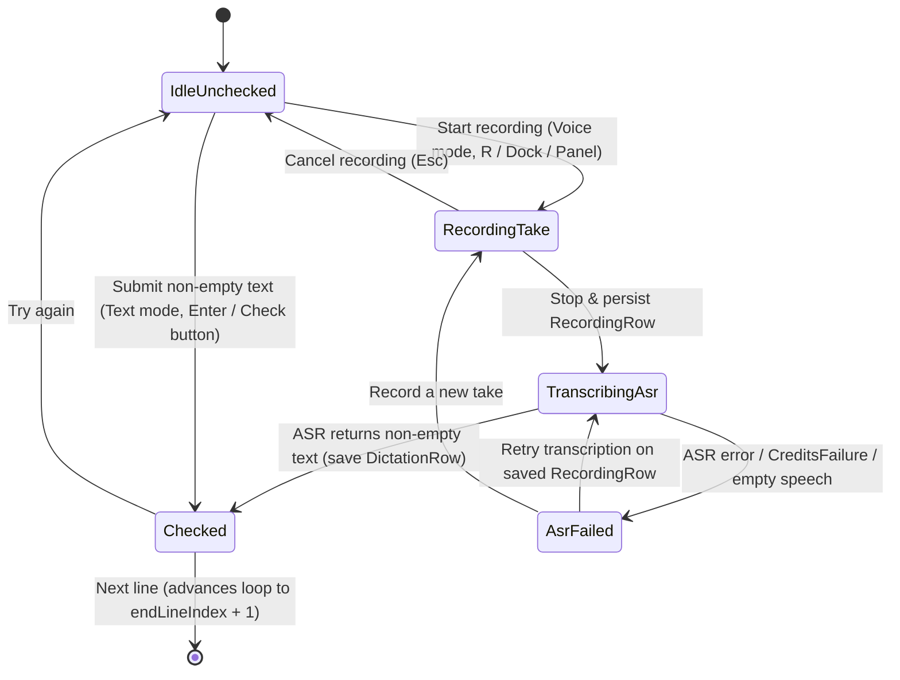

# Data Model: Dictation Practice (Voice Retelling & Text Input)

**Feature**: [spec.md](spec.md) | **Date**: 2026-11-11

## 1. Persistence Entities (Drift `AppDatabase`)

### 1.1 `Dictations` (`DictationRow` — existing table in `lib/data/db/tables/dictations.dart`)

No schema migration is required. All columns are already present in `AppDatabase`:

| Column | Dart Type | Description / Validation |
|---|---|---|
| `id` | `String` (PK) | UUID v4 identifying the dictation attempt |
| `targetType` | `String` | `'Audio'` or `'Video'` (Dexie target type convention) |
| `targetId` | `String` | Media UUID (`mediaId`) |
| `referenceStartMs` | `int` | Loop start time in milliseconds (`(startSec * 1000).round()`) |
| `referenceDurationMs` | `int` | Loop duration in milliseconds (`((endSec - startSec) * 1000).round()`) |
| `referenceText` | `String` | Plain reference text of the loop lines |
| `language` | `String` | BCP-47 language tag of the media/practice session |
| `userInput` | `String` | Trimmed text from ASR transcription (Voice Retelling) or keyboard (Text Input) |
| `accuracy` | `int` | Percentage `0..100` (`round(correctWords / (totalWords + extraWords) * 100)`) |
| `correctWords` | `int` | Number of matched words (`>= 0`) |
| `missedWords` | `int` | Number of reference words omitted by the learner (`>= 0`) |
| `extraWords` | `int` | Number of extra words added by the learner (`>= 0`) |
| `syncStatus` | `String` | `'local'` / `'pending'` / `'synced'` (from `SyncMetadataColumns`) |
| `serverUpdatedAt` | `DateTime?` | Server timestamp when synced |
| `createdAt` | `DateTime` | Local creation timestamp (used for `DESC` ordering in history) |
| `updatedAt` | `DateTime` | Local update timestamp |

### 1.2 `Recordings` (`RecordingRow` — existing table in `lib/data/db/tables/recordings.dart`)

Used unchanged by `ShadowTakeStore` when capturing voice-retelling takes in Dictate mode:
- Stores the 16 kHz mono PCM16 WAV at `{appSupport}/recordings/{uuid}.wav` (`localPath`), `referenceStart`, `referenceDuration`, `referenceText`, `language`, `duration`, `md5`, `pronunciationScore`, `assessmentJson`, and enqueues `SyncEntityType.recording`.

### 1.3 `EchoSessions` (`EchoSessionRow` — existing table in `lib/data/db/tables/echo_sessions.dart`)

Persists both `echoActive` and `blurActive` alongside `echoStartLine`, `echoEndLine`, `echoStartMs`, `echoEndMs`:
- `echoActive == true && blurActive == false` → restores into `PlayerLens.echo`.
- `echoActive == true && blurActive == true` → restores into `PlayerLens.dictate` on the saved loop region.
- `echoActive == false && blurActive == false` → restores into `PlayerLens.listen`.

---

## 2. Domain Models (`lib/features/dictation/domain/`)

### 2.1 `DictationInputMode`

```dart
enum DictationInputMode {
  voice, // Default: Voice retelling (record take -> ASR -> diff)
  text,  // Alternative: Keyboard text input -> diff
}
```

### 2.2 `DictationChange` & `DictationStats` (`dictation_diff.dart`)

- **`DictationChange`**:
  - `value` (`String`): space-separated normalized words in this diff chunk (preserving leading/trailing separator spaces on removed chunks for inline rendering).
  - `added` (`bool`): `true` when words were spoken/typed by the learner but absent from the reference.
  - `removed` (`bool`): `true` when words were in the reference but omitted by the learner.
- **`DictationStats`**:
  - `totalWords` (`int`): `correctWords + deletions` (reference word count).
  - `correctWords` (`int`): matched word count.
  - `insertions` (`int`): extra word count (`extraWords`).
  - `deletions` (`int`): missed word count (`missedWords`).
  - `accuracy` (`int`): `0..100`.
- **`DictationCheckResult`**:
  - `changes` (`List<DictationChange>`)
  - `stats` (`DictationStats`)
  - `userInput` (`String`)
  - `recordingId` (`String?`): non-null when produced from a Voice Retelling `RecordingRow`.

### 2.3 `DictationBandWord` (`dictation_band_words.dart`)

- `text` (`String`): normalized dictation word (`dictationWordOf`).
- `startSec` (`double`): absolute media start time in seconds.
- `endSec` (`double`): absolute media end time in seconds.
- `blockWidth` (`double`): visual width in logical pixels (`dictationBlockWidth(text)`).

---

## 3. Application State & Transitions (`DictationSessionState`)

Scoped to the active loop key `(mediaId, startLineIndex, endLineIndex)` so moving the loop, expanding/shrinking lines, or changing media starts with a clean attempt state:



### State Fields (`DictationSessionState`)

- `inputMode` (`DictationInputMode`): `voice` (default) or `text`.
- `isTranscribing` (`bool`): `true` while `AsrService.transcribe` is in flight for a recorded take.
- `checkResult` (`DictationCheckResult?`): non-null when the current attempt has been checked.
- `lastRecordedTake` (`RecordingRow?`): the most recent take recorded in this dictation loop (used for one-tap ASR retry if transcription fails).
- `failure` (`DictationFailure?`): typed failure (`emptySpeech`, `credits(CreditsFailure)`, `serviceError(String?)`) when ASR transcription fails.
